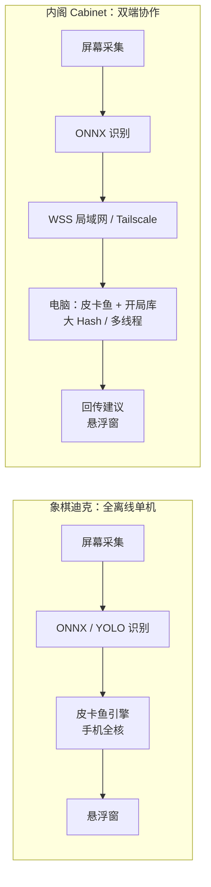

# 象棋迪克（XQDK）技术报告

> 版本：versionName 3.0 · 包名 `com.xqdk.chess` · 构建：Gradle 8.10.2 / AGP 8.8.2 /
> Kotlin 1.9.24（JDK 17）
> 本报告面向希望理解、复用或二次开发本项目的开发者，重点讲清"连线"识别管线的
> 设计决策与踩坑记录。功能向说明见 [assist-helper.md](assist-helper.md)。

---

## 1. 项目概述与合规定位

象棋迪克 = **连线**（自研：ONNX 角点式/YOLO 屏幕识别 → 桔库/引擎分析 → 悬浮窗建议），
聚焦单一功能；皮卡鱼引擎链路承自 DroidFish 衍生基座（对弈/打谱已于 2026-10-29 裁撤）。

合规边界是设计的第一约束，所有功能都在"只读识别 + 建议"框架内：

| 允许 | 明确不做 |
| --- | --- |
| MediaProjection 录屏（用户主动授权） | 触摸/手势注入（`dispatchGesture`、注入 MotionEvent） |
| `SYSTEM_ALERT_WINDOW` 悬浮窗 | 无障碍服务（AccessibilityService） |
| 本地引擎分析、本地开局库 | Root / Xposed / 读写其他应用数据 |
| 玩家手动完成所有走子 | 任何形式的自动走子 |

该边界同时决定了权限面（仅录屏 + 悬浮窗）与产品形态（识别与建议，走子由人完成）。

## 2. 总体架构

```
app/
├─ com.xqdk.chess.assist            # 连线（自研，纯 JVM 核心可单测）
│   ├─ ScreenAssistService.kt       # 前台服务：采集调度/引擎切换/悬浮窗/建议编排
│   ├─ OnnxBoardRecognizer.kt       # ONNX 两步式识别（默认引擎）：角点检测 + 全盘分类
│   ├─ OnnxGeom.kt                  # ONNX 几何预处理：仿射/透视/resize（纯 JVM 热路径）
│   ├─ YoloBoardDetector.kt         # TFLite 推理封装（回退引擎：裁剪推理、输入预处理）
│   ├─ YoloPostprocessor.kt         # 输出解码 + 类别感知 NMS + 一致性过滤
│   ├─ DetectionBoardMapper.kt      # 检测框 → 9×10 棋盘映射 + 朝向判定
│   ├─ RecognitionTypes.kt          # Frame/RecognitionResult/BoardTracker
│   ├─ AssistBoard.kt               # 棋盘抽象：FEN、合法性校验、走子推断
│   ├─ AnalysisEngine.kt            # 独立 Pikafish UCI 进程驱动
│   ├─ MoveChinese.kt               # UCCI → 中文着法（复用 gamelogic 规则）
│   └─ ui/                          # 连线页与悬浮窗面板（AssistActivity/OverlayPanelView）
├─ com.xqdk.chess.gamelogic         # 棋规引擎（Board/Position/Move/Piece/Zobrist，源自基座）
├─ com.xqdk.chess.openbook          # 开局库（SQLite 桔库 + Zobrist 查询）
└─ org.petero.droidfish             # GPL 引擎胶水层（UCI 进程、EngineListener）
```

分层原则：**识别与映射的全部逻辑放在纯 JVM 类**（无 Android 依赖），Android 层只做
采集、渲染、线程调度——这是单测覆盖率（85 例）能落地的关键。

## 3. 连线识别管线（核心技术）

双引擎主备：**ONNX 两步式（默认）** 与 **YOLO 检测式（回退）**。连线页"识别引擎"
单选可运行中热切换（`switchEngine` 按加载代际释放 native 会话，快速来回切不泄漏）；
ONNX 模型缺失/加载失败自动回退 YOLO 并在状态栏提示。

### 3.1 采集（ScreenAssistService）

- MediaProjection → `VirtualDisplay` → `ImageReader`（RGBA_8888，双缓冲）。
- **像素转换快路径**：`pixelStride==4` 时按行批量 `buffer.get` 读入复用字节数组，
  在 JVM 内一次性解 RGBA→ARGB，避免每像素 4 次单字节 JNI 调用（整屏 1080×2280
  每帧约 246 万次 JNI 调用 → 2280 次批量调用）。
- 帧率两档：常态 220ms；仅当**悬浮窗与棋盘矩形相交**时降为 1400ms，且取帧前把
  面板隐藏约 60ms、取完即恢复（录屏镜像会把悬浮窗录进画面，遮挡棋盘时必须让位）。
  交叠判断用 `AssistConfig.frameSize`（采集启动时记录）把归一化棋盘框换算回像素。
  *踩坑：frameSize 曾只读不写导致该机制整体失效——悬浮窗拖到棋盘上时 YOLO 会把
  迷你棋盘也识别进局面。*
- `ImageReader` 的帧**必须取走并 close**（哪怕节流跳过），否则缓冲池耗尽后回调停发。

### 3.2 ONNX 两步式识别（默认引擎）

模型与算法来源 [Chinese_Chess_Recognition](https://huggingface.co/spaces/yolo12138/Chinese_Chess_Recognition)，
工程实现移植自 chinese-chess-helper 的 OnnxRecognizer（`OnnxBoardRecognizer`）：

1. **角点检测（RTMPose）**：全图 bbox 外扩 1.25 倍仿射到 256×256，SimCC 输出
   argmax 解码四个棋盘角（A0 左上 / A8 右上 / J0 左下 / J8 右下），再逆仿射回原图。
2. **透视校正**：单应变换把棋盘拉到 450×500 俯视图，角点固定落在
   (50,50)/(400,50)/(50,450)/(400,450)，裁出 400×450 的纯棋盘区。
3. **交叉点分类（Swin）**：裁剪区缩放到 280×315，对 90 个交叉点各输出 16 类
   logits（空 / 未知 / 红七子 / 黑七子），argmax 成局面。

- 与 YOLO 相比：角点定位 + 全盘分类对未收录的棋盘皮肤泛化更好；四角语义天然给出
  朝向，不依赖 board 框（后者逐帧会跳变）。模型共约 21.5MB，缺失时回退 YOLO。
- 角点约束（`AREA_MIN_RATIO/ASPECT_*`）：包围盒占帧面积 2%–120%、宽高比 0.5–2.2；
  单帧最少 3 子（与 YOLO 路径同口径，残局可识别）。
- **角点缓存与复检**：命中会话网格时复用角点，超过 8s（`POSE_RECHECK_MS`）强制
  全图重定位；连续 3 帧产出结构非法局面（走子动画过渡帧常客）同样强制重定位。
- **自适应退避**：下一帧最小间隔 = max(250ms, 上次识别耗时×2)（`onnxLastCostMs`），
  慢机不至于把 worker 线程压满。
- **几何热路径**（`OnnxGeom`，纯 JVM）：透视变换行内预乘 + 求倒数合并两次除法、
  resize 的 x 方向映射查表；ORT 会话 4 线程、tensor 与中间缓冲全复用。
  XNNPACK 不启用（arm64 崩溃 #21696/#22981）。

### 3.3 YOLO 推理与后处理（回退引擎）

- 模型：YOLOv5n fp16，640×640，TFLite，4 线程；输出 `[1,25200,20]`
  （4 框参数 + objectness + 15 类：14 类棋子 + 1 整体棋盘框）。**输入是 RGB 不是 BGR**
  （BGR 会红黑阵营互换）。
- letterbox 预处理；裁剪推理：已有会话网格时只送棋盘外扩 1.2 格的区域
  （尺寸下取 16 的倍数以复用裁剪位图），显著提高小棋子的有效分辨率。
- 后处理（`YoloPostprocessor`，纯 JVM）：
  1. objectness/类别分双阈值（0.60）过滤；
  2. **类别感知 NMS**（IoU 0.45）；
  3. 棋子框长宽比 ∈ [0.7, 1.3]（排除按钮/横幅等长条误检）；
  4. 相对"棋子宽度中位数"偏差 >[0.55, 1.6] 的框剔除（杀掉"轮到红方"圆形标记等
     同屏异物，对被走子标记环遮挡的真棋子保留宽松边界）。

### 3.4 检测 → 棋盘映射（DetectionBoardMapper）

- **网格锚点优先**：模型的整体 board 框（长宽比 0.7–1.3 且 ≥ 平均棋子 7×8 格距）
  直接给出 8×9 格距，棋子中心 round 到最近交点。
- **兜底锚点**：board 框缺失/畸形时用棋子中心包围盒（≥20 子才可信 + 最小棋子间距
  与跨度相容性检查）——残局时 board 框常丢，此路径保识别下限。
- `minPieces = 3`：只挡"整屏无棋盘"。残局可低至 3 子，门槛再高会把合法残局永远
  拒之门外；**合法性由规则校验把关，数量门槛只做粗筛**（两层职责分离是踩坑后
  的教训：曾用 10 子门槛导致某残局界面识别彻底失效）。
- 越界丢弃、同格冲突保留高分者、朝向由双王行位判定（帅在下 = 红方在屏幕下方）。

### 3.5 稳定化与合法性（BoardTracker / AssistBoard）

- **首次确认需连续 3 帧逐格一致**（瞬时幻觉帧极难连续多帧完全一致）；确认后与开局
  全对照（≥32 子一致）判"新对局"。
- **子数跳变门限** `abs(new - old) > max(2, old/10)` 判 UNSTABLE：真实走子子数变化
  ∈ {0,-1}，±3 以上的跳变几乎必然是遮挡/动画/幻觉。该检查放在重开检测**之后**
  （换局常伴随大幅子数变化，先给重开检测机会）。
- **规则校验**（`AssistBoard.validate`）：帅/将各一、各类子数上限、总数 ≤32——
  把幽灵局面挡在确认之前。
- 轮次推断：`movedSide` 对比新旧局面，新增子所在阵营 = 刚走子方 → 下一手对方。
  差分偶发失败由"更新棋局"按钮人工纠偏兜底。

## 4. 引擎分析链路（AnalysisEngine）

- **独立 UCI 进程**：单一串行线程执行初始化/搜索，同一时刻只有一个 `position+go`。
- 握手协议：`uci` → 读 uciok 注册 options；`initConfig()` 必须在 uciok 后调用，
  否则 ExternalEngine 的启动看门狗会在 10s 后误报 "UCI protocol error"；
  再 `ucinewgame + isready` 等 readyok。
- 搜索制式：深度制 `go depth N`（12/20/24 三档）与时间制 `go movetime X`（0af60e1
  起，SearchMode 可选）；另有 `flashStop()` 闪电出着（stop 立即采纳当前最优）；
  MultiPV 1-3 可调（悬浮窗"3变"档，两次搜索间 setOption）、Threads=核心数、
  NNUE 内置权重。
- **Hash 热更新**：`setHash()` 只更新 volatile 值，在下一次 `searchOnce` 开头
  （两次搜索之间）才下发 `setoption`——UCI 不建议搜索中 setoption。
- **并发打断**：`request()` 直接写 `stop` 打断旧搜索，旧 bestmove 返回后按 FEN
  比对丢弃（调用方只接受 `result.fen == currentFen` 的结果）。
- **健壮性**：读行返回 null = 输出流关闭（进程死亡/关停）立即退出——
  *踩坑：曾 `?: continue` 导致引擎死后最长 60s 忙等自旋*；60s 兜底超时发 stop
  再收 1.5s；启动失败自动重试一次，仍失败把错误显示到悬浮窗状态栏。
- 超时无引擎输出时的"string"行转发 logcat，便于远程诊断（如 NNUE 加载失败）。

## 5. 建议生成与展示

- **我方回合**：先查本地开局库（Zobrist vkey，按 BEST_SCORE 排序）——命中即零
  等待展示且不占用引擎；未命中走引擎深度搜索。
- **成熟度（箭头变绿）**：开局库命中直绿；引擎搜索中若最佳着法连续 1200ms 未变
  （迭代加深中浅层波动大、中深层稳定值近似终值）或已收 bestmove 则定着变绿。
- **送子防线**：着法起点必须是我方棋子（`fromIsOurs`）才画箭头——轮次错乱/幽灵
  FEN 时宁可不给建议，避免"我方打我方"的误导。
- **对方回合**：只出文字预案（"若对方走X 我方应Y"，用 `pv[0]`/`pv[1]`），不画
  箭头——把应手画在当前盘面上会指向我方棋子。
- 中文着法复用 gamelogic 的 `Move.getChsString`（`MoveChinese.describe`，容错降级
  为原样 UCCI）。

## 6. 悬浮窗与交互

- `TYPE_APPLICATION_OVERLAY` + `FLAG_NOT_FOCUSABLE`；面板三列布局（状态列/
  迷你棋盘/按键列），迷你棋盘与主界面共用同一套棋盘/棋子位图与 1240×1340 基准
  几何，随被识别屏幕朝向"随动"（红上则迷你棋盘也红上）。
- **拖动**：全区域拖动（`onInterceptTouchEvent` 按滑动阈值拦截），位置按屏幕归一化
  持久化，重建时钳制回屏内（面板尺寸调整后旧位置可能整体出屏）。
- **关闭二次确认**：首次点按变红"确认关闭?"，3 秒内再点才真正关闭（录屏与面板
  耦合关闭，防误触中断指导）。
- **紧急手动模式**：识别彻底失效时暂停帧识别，用户在迷你棋盘上"点子选中 → 点目标
  格=走子（自动翻轮次）/ 再点选中子=删除（帅/将不可删）"。历史栈语义：
  `history.last` 恒等于当前显示局面，编辑后入栈，悔棋可逐步回退手工编辑。
- **连线页即 launcher**（2026-10-29 砍主页跳转层）：打开应用直达连线页（免责弹窗
  随启动弹出），页面结构 = 识别点阵 + 状态行 + hero + 河界线 + 三步授权清单
  （①悬浮窗权限 ②通知权限 ③屏幕录制按需）+ 主按钮（开始/停止识别，运行态换
  警示描边"停止指导"）+ 设置区（悬浮窗主题循环 / 识别引擎单选 / 思考制式单选）+
  底部帮助/关于入口。
- **思考制式联动**：连线页"深度制/时间制"单选热更新引擎（`go depth N` /
  `go movetime X`），悬浮窗深度/时间芯片按制式互斥显示；时间制时长档
  1/2/3/5/10/30 秒循环。悬浮窗右列另有"闪电"按钮：打断当前搜索立即采纳
  当前最优（引擎空闲时提示不误导）。

## 7. 开局库与降级守护

- 开局库：SQLite 资产库（`sqliteassethelper`）+ Zobrist 键查询（`BHOpenBook`），
  连线建议链先查库（命中零等待回着法），未命中才引擎搜索。
- **降级守护**：开局库资产缺失时（开源构建不内置第三方桔库）`ScreenAssistService`
  捕获初始化异常降级（`openBookFailed`）为纯引擎模式。*这是让开源副本开箱即用的关键。*
- 对弈/打谱基座（GameController/ComputerPlayer/XQF 解析/filepicker）已于
  2026-10-29 裁撤（f5215c3），本节仅存桔库与降级语义。

## 8. 原生层与引擎分发

- `app/src/main/cpp/nativeutil`（NDK 构建）：为引擎进程提供 `chmod 744` 与 `reNice`
  的 JNI 实现——Android Q 起无法直接执行 app 私有目录二进制，方案是把引擎 so 放入
  `applicationInfo.nativeLibraryDir`（系统负责解压与权限）作为进程启动。
- 两个引擎变体经 productFlavors 选择：`armv8`（基础 NEON）与 `armv8-dotprod`
  （需 ARMv8.2+ dotprod 指令，骁龙855/麒麟990/天玑1000+），通过
  `BuildConfig.PIKAFISH_ENGINE_FILE` 注入。引擎、NNUE 权重、ini 以
  `nativeLibsToJar` 打进 APK 的 lib 目录。
- 引擎可执行文件命名带 `.so` 后缀 + 伪装 ini 文件，规避部分厂商 ROM 对非常规
  可执行文件的清理。

## 9. 工程化与测试

- **可测性设计**：识别管线核心（YoloPostprocessor/DetectionBoardMapper/BoardTracker/
  AssistBoard/MoveChinese/OnnxGeom/AnalysisEngine 解析层）全部为纯 JVM 类，单测 85 例
  （10 个测试类）覆盖：映射边界（越界丢弃/冲突/兜底锚点/翻转朝向）、跟踪器语义
  （三帧确认/重开/跳变拒绝）、FEN 往返、手动走子与 applyUcci 契约一致、ONNX 透视与
  resize 几何、引擎 info 行解析等；Robolectric 仅用于服务/页面启动冒烟与悬浮窗渲染。
- `versionCode` = git 提交数（经 `providers.exec` 求值，配置缓存复用时仍随提交数更新；
  无 git 环境兜底为 1），并设 `coerceAtLeast(43)` 地板——2026-10-29 公开仓按"已有历史 +
  单笔稳定版"压平后提交数回落到 24，地板保证 vc43 拍板交付版不被判降级；提交数超过 43
  后地板自动失效。APK 产物名 `XQDK_${日期}_${versionCode}_${变体}.apk`。
- 构建变体：`testArmv8-dotprodDebugUnitTest` / `assembleArmv8-dotprodRelease`
  为主要任务；`armv8` 变体用于老设备兼容。

## 10. 性能与已知限制

- 识别节奏受 `MIN_RECOGNIZE_INTERVAL_MS=250` 节流，建议延迟主要由引擎搜索深度决定
  （深度 20 常见 1–3s，简单局面秒出）。
- **YOLO（回退引擎）**：模拟器（x86_64）实测全屏帧约 300–570ms（4 线程 fp16），
  裁剪推理更低；真机（骁龙 8xx 级别）明显更快。
- **ONNX（默认引擎）**：模拟器 x86_64 靠镜像自带的 ARM 转译执行，单帧约 2–6 秒，
  只够功能联调（转译慢数倍属预期，非实现问题）；真机原生 arm64 未做系统基准，
  自适应退避会按实机耗时自动放宽帧间隔，不压满 worker。角点命中时跳过第一步检测，
  稳态主要开销在透视 + 分类。
- ONNX 管线 CPU 几何段已收口（2026-10-29）：推理侧 direct tensor + 全缓冲复用 +
  角点缓存复用（3be3066 起）；几何热路径透视变换求倒数合一、resize 坐标查表
  （`OnnxGeom.warpPerspectiveInto/resizeBilinearInto`）。XNNPACK 不启用
  （arm64 崩溃 #21696/#22981）；模型不动，长线提速挂账姊妹仓自产小模型。
- 已知限制：
  - 只构建 arm64-v8a（2026-10-28 删 x86_64 ABI 减体积，模拟器联调需临时加回）；
    引擎可执行文件本身仅有 arm64 变体，x86_64 模拟器上分析引擎本就无法运行；
  - `armv8-dotprod` 变体需 ARMv8.2+，老设备请用 `armv8` 变体；
  - 开源构建不内置第三方开局库（版权物），连线自动降级为纯引擎模式，功能完整。
- 死代码清理记录（0-10 轮）：全仓删除 7 个零引用文件与约 50 处死成员；扫描需注意
  **Kotlin 属性语法（`bd.drawNum` → `getDrawNum()`）会让 Java getter 的引用计数
  失真**，删前必须按属性名复查。

## 11. 许可证说明

- 本项目为 [DroidFish](https://github.com/peterosterlund2/droidfish)（GPL-3.0）的
  衍生作品并直接包含其衍生代码（`org.petero.droidfish` 包、gamelogic 棋规等），
  因此**整体以 GPL-3.0 发布**（仓库根 LICENSE）。上游若为 MIT 的历史遗留标注
  不再适用于本仓库的衍生代码。
- Pikafish 引擎与 NNUE 权重（GPL-3.0）、YOLO 权重（来自 VinXiangQi）随仓库分发，
  均在 README 鸣谢中标明来源。
- 第三方版权内容（桔库开局库、内置棋谱书）**不随本仓库分发**，获取方式见 README
  "从源码构建"一节。

## 12. 与内阁 Cabinet 的选型对比（含发热边界）

同作者的 [内阁 Cabinet](https://github.com/Silva6c/cabinet) 是同一"识别 + 建议"思路的
另一条路线：**手机做眼睛，电脑做脑子**。两者共用同一套 ONNX 两步式识别与皮卡鱼引擎，
差别在算力落点：



| 维度 | 象棋迪克（本项目） | 内阁 Cabinet |
|---|---|---|
| 部署 | 装 APK 即用，零外部依赖 | 手机端 + 常开 Windows 电脑 + 一次扫码配对 |
| 算力落点 | 手机 SoC（大小核混跑） | 电脑 CPU / 内存 |
| 引擎 Hash | 256MB–2GB（受手机内存约束） | GB 级可调 |
| 搜索线程 | 手机核心数 | 电脑核心数 |
| 手机负载 | 采集 + 识别 + 搜索**三路并发** | 采集 + 识别（搜索在电脑） |
| 发热 | **长时间明显发热，温控降频后识别变慢** | 手机基本不热 |
| 延迟构成 | 本地无网络往返；但降频后单帧变慢 | 局域网毫秒级往返；手机不降频，节奏稳定 |
| 建议信息 | 走法箭头 / 中文着法 / 优劣势 / 深度 / MultiPV | 另含胜率、WDL、多路 PV、算力悬浮窗直调 |
| 适用场景 | 随手练棋、无电脑环境、短时使用 | 深度复盘、长时间连续使用、追求最强引擎 |

### 12.1 发热与降频的技术根因（为什么单机方案必然发热）

连线期间手机同时承担三路持续负载，且都在 CPU 上：

1. **采集与像素转换**：1080×2280 RGBA 每帧 ≈ 246 万像素，按行批量转换后仍在 JVM 内逐像素解包；
2. **神经网络推理**：ONNX 角点 256×256 + 透视 450×500 + 分类 280×315×90 交叉点，ORT 4 线程；
   回退 YOLO 对 640×640 整帧推理；
3. **皮卡鱼搜索**：搜索线程数 = 手机全部核心，深度制下持续跑 NNUE 评估。

三者在 worker 线程与引擎线程上并发，CPU 接近满负荷。连续数分钟后 SoC 触及温控阈值，
系统降频或关核——这不是实现缺陷，而是"手机做全部工作"的物理边界。降频后的链路表现：


应对设计：自适应退避保证降频时不会堆任务、不会卡死；时间制（`go movetime`）让出着节奏
可预期；引擎可切 YOLO 降低推理开销。但这些只缓解不根治——**长时间高强度使用请选内阁**，
手机不承担搜索负载，发热与降频问题从架构上消失。

### 12.2 选型一句话

- **想开箱即用、没有（或不想开）电脑、短时使用** → 象棋迪克；
- **长时间连续使用、追求最强引擎与最丰富建议、有常开电脑** → 内阁 Cabinet。
